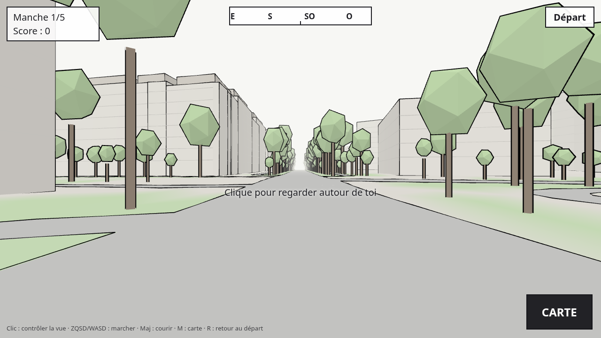

# Paris Guessr — version Three.js

Un GeoGuessr de Paris en 3D, directement dans le navigateur (ordinateur et mobile), recréé à partir des données 3D de l'IGN, en rendu « outlined » sans aucune texture.

**Jouer : https://doriang-epitech.github.io/ParisGuessr3JS/**

C'est la version web native (Three.js + Vite, sans Unity) du [Paris Guessr Unity](https://github.com/DorianG-Epitech/ParisGuessr) : mêmes données, même gameplay, même rendu, mais un téléchargement initial d'environ 2,5 Mo au lieu d'environ 18 Mo.



## Principe

- Tu atterris en vue FPS dans une rue aléatoire de Paris (6 000 points de départ dans les 20 arrondissements).
- Tu te promènes pour trouver des indices, puis tu ouvres la carte et tu poses ton repère.
- Score de la manche : `5000 × e^(−distance / 1200 m)` (5 000 si tu es à moins de 25 m).
- Une partie dure 5 manches, avec un récapitulatif à la fin et un bouton Rejouer.

## Contrôles

| | Ordinateur | Mobile |
|---|---|---|
| Regarder | souris (clic pour capturer le pointeur) | glisser sur la moitié droite |
| Marcher | ZQSD / WASD / flèches | joystick (moitié gauche) |
| Courir | Maj | pousser le joystick à fond |
| Carte | M ou Espace | bouton CARTE |
| Retour au départ | R | bouton Départ |
| Zoom carte | molette, + / − | pincer, + / − |

## Rendu outlined

- **Faces** : couleurs plates par vertex (façades, toits mansardés, trottoirs, chaussée, verdure, eau), avec un léger éclairage directionnel et un brouillard linéaire (60 à 330 m, 270 m sur mobile).
- **Contours** : de vraies lignes à épaisseur constante en pixels. Chaque segment devient un quad étendu dans le vertex shader à partir de l'extrémité opposée, puis rapproché de la caméra pour passer devant ses faces. Les arêtes de bâtiments, les toits, les bordures de trottoir et les étages (traits fins tous les 3 m) sont dessinés ainsi.
- **Arbres** : contour par « coque inversée », c'est-à-dire les faces arrière gonflées d'un nombre constant de pixels.
- **Routes** : mêmes couleurs que la carte 2D. Les grands axes (importance IGN 1–2 et voies autoroutières) sont jaunes, les axes d'importance 3 sont jaune clair et les autres rues sont blanches.

## Arbres

Les 198 864 arbres de Paris (hors bâtiments) ont une forme qui dépend de leur genre botanique :

| Forme | Genres | Arbres |
|---|---|---|
| Rond (tilleul, érable, sophora…) | les autres genres | 88 518 |
| Platane : couronne large à deux lobes, tronc clair | *Platanus* | 40 114 |
| Marronnier : dôme dense, vert foncé | *Aesculus* | 22 847 |
| Fleuri, rose (cerisier, pommier, magnolia…) | *Prunus, Malus, Cercis, Magnolia…* | 16 506 |
| Petit ornemental | *Pyrus, Corylus, Crataegus, Sorbus…* | 13 316 |
| Conifère : deux cônes empilés | *Pinus, Taxus, Cedrus, Chamaecyparis…* | 11 315 |
| Élancé (peuplier, ginkgo, bouleau, tulipier) | *Populus, Ginkgo, Betula, Liriodendron* | 6 248 |

La hauteur vient du jeu de données. Si elle manque ou n'est pas plausible, elle est estimée à partir de la circonférence ou du stade de développement. Le tronc a son vrai diamètre, et la couronne est limitée par la distance au bâtiment le plus proche pour ne pas traverser les façades.

## Stations de métro

Les 953 accès au métro dans l'emprise du jeu sont placés à leur vraie position et orientés dans l'axe de la rue. Chacun est une trémie avec ses marches et sa balustrade, et on ne peut pas tomber dedans. Il y a deux modèles : un mât avec le disque jaune « M » ou un portique vert avec lanternes inspiré de Guimard. Le modèle est tiré au hasard, car les données ne précisent pas le type d'entrée. Il n'y a ni numéro de ligne ni nom de station, pour ne pas donner la réponse.


- Toute la géométrie est extrudée dans le navigateur à partir d'empreintes compactes.

## Données

Paris est découpé en 3 073 tuiles de 250 m au format binaire `PGT2`, soit environ 12 Ko gzippés par tuile et 36,5 Mo au total. Chaque tuile contient le relief, les emprises de bâtiments avec leurs hauteurs, les routes avec leurs largeurs et leur classe de couleur, les bordures, les arbres avec leur forme et les accès au métro. Le jeu ne télécharge que les tuiles proches du joueur, dans un rayon de 420 m (340 m sur mobile). Une rue est prête en 0,2 à 0,4 s.

Pour régénérer les tuiles : `python3 tools/build_tiles.py`. Le script a besoin des données brutes IGN, des arbres et des accès métro dans `$PG_DATA`, voir les scripts `fetch_*` du [repo Unity](https://github.com/DorianG-Epitech/ParisGuessr/tree/main/Tools). Les accès métro viennent des jeux IDFM `acces`, `relations-acces` et `zones-d-arrets`. La carte et les points de départ viennent du projet Unity (`tools/prepare_data.py`).

## Développement

```bash
npm install
npm run dev       # serveur local
npm run build     # build dans docs/ (servi par GitHub Pages)
```

Le code se trouve dans `src/` :

- `world.js` : métadonnées et points de départ ;
- `tilebuilder.js` : extrusion des tuiles ;
- `streamer.js` : chargement en continu, sol et collisions ;
- `shaders.js` : faces, lignes et coque ;
- `main.js` : jeu, entrées, carte et interface.

## Crédits

- **IGN, BD TOPO®** (bâtiments, routes, hydrographie, végétation, arrondissements) et **RGE ALTI®** (relief), via la Géoplateforme : Licence Ouverte Etalab 2.0.
- **Ville de Paris, « Les arbres »** (opendata.paris.fr) : Open Database License (ODbL).
- **Île-de-France Mobilités, « Référentiel des arrêts : Accès »**, relations accès et zones d'arrêts (data.iledefrance-mobilites.fr) : Licence Ouverte Etalab 2.0.
- [Three.js](https://threejs.org) (MIT) et [fflate](https://github.com/101arrowz/fflate) (MIT).
